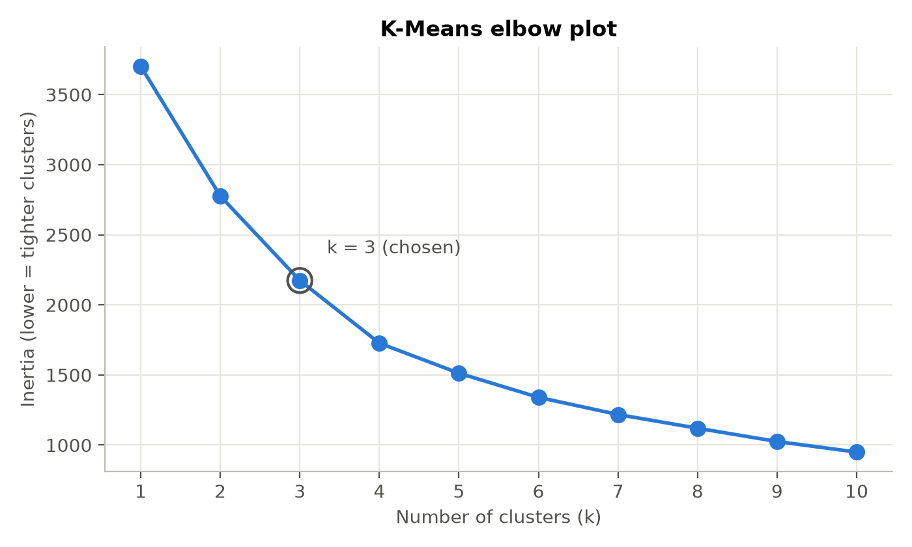
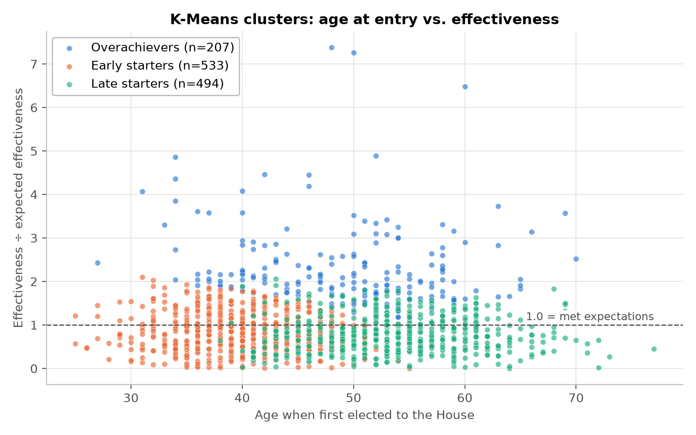
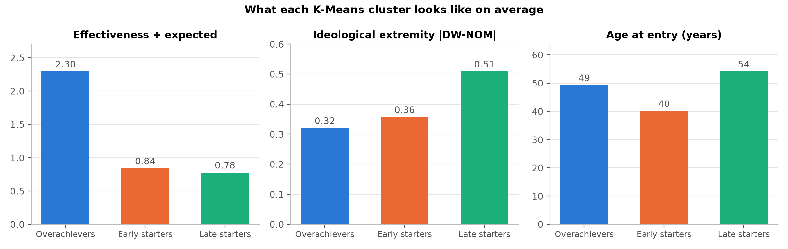
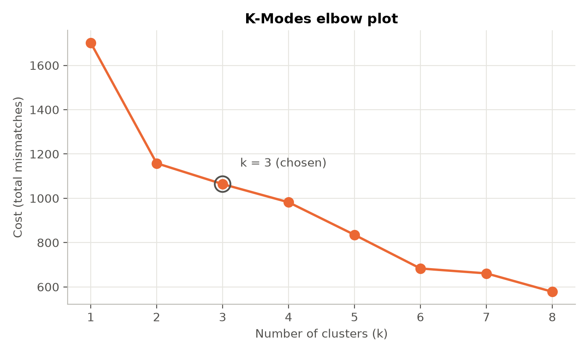
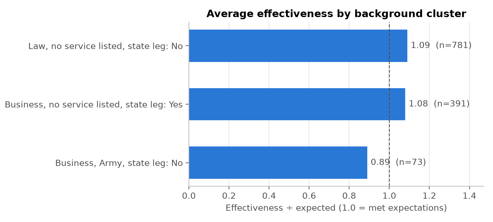

Sasha Richardson

DATA 78000, AI and Machine Learning for Artists and Humanists

Data Clustering Assignment

[Link to Assignment Github][githubRepoLink]

## 1. Research question(s)

There is an old line in Congress that members are either workhorses or showhorses. Workhorses do the slow committee work and actually get bills passed. Showhorses chase attention. I wanted to see whether that split shows up in the data on its own. So I asked two questions.

1. If I group House members by how effective they are, how ideological they are, and how old they were when they arrived, do recognizable "types" appear?
2. Do members with similar backgrounds (their jobs before Congress, military service, and state legislative experience) also end up with similar effectiveness?

## 2. Data

I joined two datasets on the BioGuide ID. That is the official ID the Congressional Biographical Directory gives every member of Congress, and Wikidata stores it as property P1157.

**Center for Effective Lawmaking (CEL), House file, 93rd–118th Congress.** CEL publishes a Legislative Effectiveness Score (LES) for every House member in every Congress. It is built from how many bills a member sponsors and how far those bills get (committee action, floor passage, becoming law), with extra weight for substantive bills. The file also includes DW-NOMINATE ideology scores, birth year, the year each member was first elected, and whether they served in a state legislature. I kept the 107th through 118th Congresses (2001–2024). That gave me 1,245 members.

**Wikidata.** I wrote a SPARQL query that pulls every person with a BioGuide ID, along with their occupations (P106), academic degrees (P512), and military branches (P241). It returned 2,465 people. All 1,245 CEL members matched a Wikidata item.

## 3. K-Means on effectiveness, ideology and age

### Preparing the features

Each member gets one row, averaged over every Congress they served in my window. The three features are

| Feature | What it means | Typical value |
|---|---|---|
| Effectiveness ÷ expected | LES divided by CEL's benchmark | median 0.88 |
| Ideological extremity | absolute DW-NOMINATE dimension 1 | median 0.40 |
| Age at entry | year first elected minus birth year | median 47 |

Eleven members were missing an ideology score or birth year and were dropped, which left 1,234.

I chose **k = 3** because the groups are easier to describe.

| Cluster | Members | Effectiveness ÷ expected | Extremity | Age at entry | % Democrat |
|---|---|---|---|---|---|
| Overachievers | 207 | 2.30 | 0.32 | 49 | 55% |
| Early starters | 533 | 0.84 | 0.36 | 40 | 53% |
| Late starters | 494 | 0.78 | 0.51 | 54 | 34% |

Categories were named after looking at each cluster's centroid.

- **Overachievers** are the clearest group. On average they got more than twice as much legislation moving as CEL would expect. They also sit closest to the ideological center. They are split evenly by party, which tells me the effectiveness ratio did its job of removing the majority-party effect.
- **Early starters** arrived young, around 40, and perform a little under expectations.
- **Late starters** arrived in their mid-50s, are the most ideologically extreme, and lean Republican. They also perform a little under expectations.

So the "workhorse" pattern does show up, and it pairs with moderation. The other two groups mostly differ by age, not effectiveness. K-Means split the remaining members along the age axis because that is where the spread was. I wouldn't call either group "showhorses." My data has no measure of attention or media presence, so I can't really test that half of the idea.

The clusters are not very distinct. Early and late starters blend into each other around age 45 to 50. K-Means will always draw boundaries, even through a continuous cloud of points, and that is mostly what happened here outside of the overachievers.

## 4. K-Modes on backgrounds

### Preparing the categories

Wikidata gave me more than 150 different occupation labels, and most members have several. I collapsed them into broad groups (Law, Business, Education, Military / police, Medicine / science, Media / arts / sports, Public service / advocacy, Other, Not listed) using a keyword rule. When someone matches more than one group, the first group in my list is used for the clustering. Wikidata doesn't say which job is someone's "main" one, so that order is my assumption. Military branches were folded into Army, Navy, Air Force, Marine Corps, Other branch, or None listed, with Reserve and National Guard units going into their parent branch.

The final three categorical features are occupation group, military branch, and prior state legislative service.

Here the elbow is clearer, and it is at **k = 2**. I went with **k = 3** anyway because the third cluster separates out the Army veterans, which is the one group with a noticeably different profile. 

| Cluster (its mode) | Members | % actually in that occupation group | % matching military mode | % matching state leg. mode |
|---|---|---|---|---|
| Law, no service listed, no state legislature | 781 | 51% | 85% | 76% |
| Business, no service listed, served in state legislature | 391 | 39% | 77% | 100% |
| Business, Army, no state legislature | 73 | 59% | 70% | 100% |

The biggest cluster is labeled "Law," but only about half of its members are lawyers. The mode is just the most common value, and it can hide a lot of variety. Prior state legislative service is doing most of the sorting, since two of the three clusters match it 100%.

## 5. Do backgrounds line up with effectiveness?

| Background cluster | Avg. effectiveness ÷ expected | % Overachievers | % Democrat |
|---|---|---|---|
| Law, no service listed, no state legislature | 1.09 | 17% | 50% |
| Business, no service listed, served in state legislature | 1.08 | 17% | 42% |
| Business, Army, no state legislature | 0.89 | 7% | 21% |

The short answer is mostly no. The two big background clusters are almost identical in effectiveness. Lawyers don't outperform businesspeople, and prior state legislative experience doesn't seem to matter much here either. The small Army-veteran cluster is the one exception. Its members fall below expectations on average, only 7% are overachievers, and 60% are late starters. But this cluster is mostly Republican and arrived later in life, so I can't tell whether military service has anything to do with it. 

[githubRepoLink]: https://github.com/srichardson0/AI---ML-for-Artists-and-Humanists/tree/main/data-clustering/assignment_submission